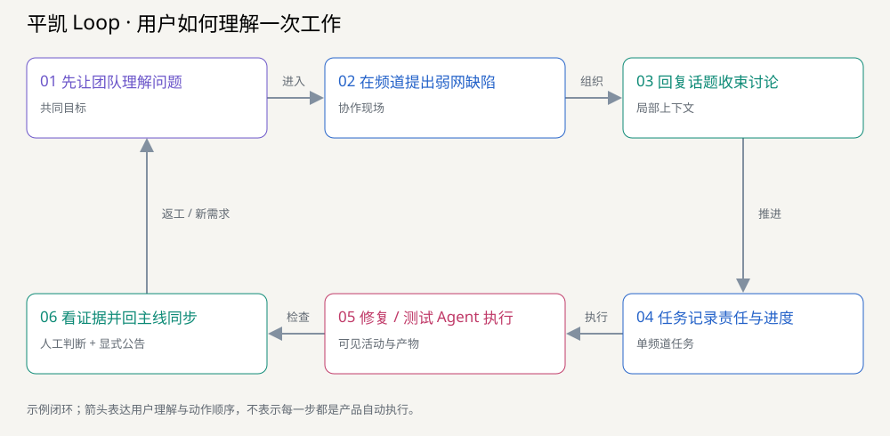
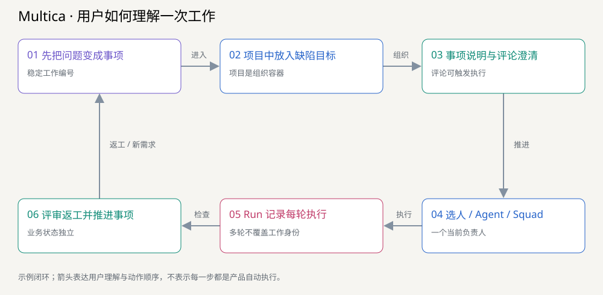
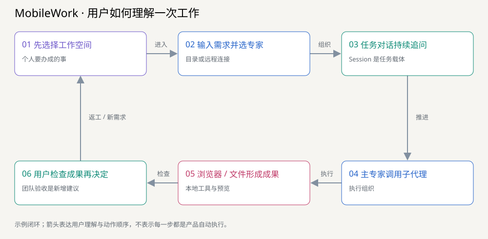

# 用户心智模型及对比

所有人物与结果是贯穿示例，非运行实录。图和步进演示见同名 HTML。

## 三种核心心智

### 平凯 Loop
先让团队理解问题 → 在频道提出弱网缺陷 → 回复话题收束讨论 → 任务记录责任与进度 → 修复 / 测试 Agent 执行 → 看证据并回主线同步

### Multica
先把问题变成事项 → 项目中放入缺陷目标 → 事项说明与评论澄清 → 选人 / Agent / Squad → Run 记录每轮执行 → 评审返工并推进事项

### MobileWork
先选择工作空间 → 输入需求并选专家 → 任务对话持续追问 → 主专家调用子代理 → 浏览器 / 文件形成成果 → 用户检查成果再决定

## 动作与预期差异

### 写一条普通回复
用户意图：我只想补充“弱网下切网会复现”，请团队知道。

- Loop：频道普通消息不默认广播给全部 Agent；任务讨论可能唤醒 Agent assignee，入口很关键。
- Multica：顶层无提及评论可能唤醒 Agent 负责人；直接回复人类不走负责人兜底。可以 /note 保证只留言。
- MobileWork：任务用户消息通常进入主专家回合。团队备注不能沿用同一默认执行语义。

容易误解：“我只是说一句”与“机器开始工作”的执行鸿沟。

来源：[L_channels](证据索引.html#L_channels)、[M_mentioning-agents](证据索引.html#M_mentioning-agents)、[W_session](证据索引.html#W_session)

### @一个 Agent
用户意图：我希望修复助手处理这段复现信息。

- Loop：需实际身份候选、可见与调用授权；可查看投递诊断。
- Multica：触发该 Agent 运行；不自动更换负责人和状态，纯文本名字不算提及。
- MobileWork：选择/召唤专家属于个人执行配置，不能直接等同多人评论派工。

容易误解：“看见名字”不等于“有权调用”；“唤醒”不等于“担责”。

来源：[L_working](证据索引.html#L_working)、[M_mentioning-agents](证据索引.html#M_mentioning-agents)、[W_experts](证据索引.html#W_experts)

### 交给一个团队
用户意图：让修复与测试协同完成，避免每个人都重复开工。

- Loop：Agent Team 只有 Agent，且创建者私有；成员需出现在频道，按 leader 与成员偏好运行。
- Multica：Squad 可含人和 Agent；指派小队先启动 Agent leader，具体成员通过真实提及参与。
- MobileWork：专家团是主专家与成员组合；成员邀请、工作分派与独立验收尚未成为已核验团队闭环。

容易误解：“一组执行者”与“多人有权有责的组织”之间的鸿沟。

来源：[L_teams](证据索引.html#L_teams)、[M_squads](证据索引.html#M_squads)、[W_experts](证据索引.html#W_experts)

### 点赞或标记结论
用户意图：我认可这条回复，但不一定批准发布。

- Loop：reaction 附属于消息，不是新消息；不能从表情推断完成验收。
- Multica：reaction 不唤醒 Agent、不改事项状态；解决讨论和选结论是另一动作。
- MobileWork：赞/踩是回答反馈，已点赞重复点击不重复上报；不是多人评审投票。

容易误解：“表示认可”“结束讨论”“业务验收”三个反馈层次。

来源：[L_channels](证据索引.html#L_channels)、[M_comments](证据索引.html#M_comments)、[W_feedback-code](证据索引.html#W_feedback-code)

### 停止或回退
用户意图：我想撤销刚才的指令，避免继续改错。

- Loop：普通发送不打断；加急才打断；Rewind 有他人消息/分支等约束，不保证外部副作用回滚。
- Multica：可停止运行，已产生的文件变化仍需单独处理；按工具能力决定插话是否不中断。
- MobileWork：停止、排队与回退到用户消息有不同路径；文件/外部系统的完整回滚未获证明。

容易误解：对话时间线与真实世界副作用之间的鸿沟。

来源：[L_rewind](证据索引.html#L_rewind)、[M_tasks](证据索引.html#M_tasks)、[W_message-code](证据索引.html#W_message-code)

### 认定工作完成
用户意图：确认缺陷消失，再向团队宣布完成。

- Loop：Browser 使用 In Review 与讨论/活动，没有一等 Review Request；Workflow Approval 是另一机制。
- Multica：Run completed 不等于 issue done；按工作流交人或由有权者更新状态。
- MobileWork：本轮收尾需最终回复和引擎空闲；多人业务验收记录是新增建议。

容易误解：机器停止、产物生成与业务目标实现之间的评价鸿沟。

来源：[L_working](证据索引.html#L_working)、[M_tasks](证据索引.html#M_tasks)、[W_session](证据索引.html#W_session)

## 同一缺陷的完整旅程

### 提出弱网缺陷
操作者：王蕾
用户看到：在所选入口写复现步骤、预期仅一条待办、实际出现两条。
系统发生：Loop 先形成话题；Multica 创建事项；MobileWork 首次发送创建 session 并开始任务。
记录：共同目标：消除重复待办；三产品的工作主键不同，不能互换

### 明确由谁处理
操作者：王蕾 / 周启明
用户看到：选择修复助手，并约定陈晓回归。
系统发生：Loop 指派/提及需按投递规则；Multica 可以只指派暂不开始；MobileWork 选择主专家，仍未形成多成员负责人模型。
记录：示例责任：周启明修复，陈晓回归；调用 Agent 与人类责任分开

### 执行第一版
操作者：修复助手
用户看到：看到执行活动、补丁 v1 与工具状态。
系统发生：可用执行环境读取上下文并运行；本地工具可能需要权限确认。
记录：示例 R1 生成补丁 v1；工具授权仅允许操作，不代表批准补丁

### 测试发现仍重复
操作者：陈晓 / 测试助手
用户看到：回归证据显示预期 1、实际 2，需要返工。
系统发生：讨论或评论记录原因；Multica 可按工作流交回开发；MobileWork 当前由用户在任务里追问，团队回归闭环属于建议。
记录：示例 QA1：失败；W17 未通过验收；R1 有输出仍不算完成

### 返工并再次验证
操作者：周启明 / 修复助手 / 陈晓
用户看到：生成补丁 v2，再跑同一弱网场景。
系统发生：重新触发后续执行并保留证据；不把回退聊天误认为撤销已写文件。
记录：示例 R2 → 补丁 v2；示例 QA2：预期 1、实际 1

### 人工判断完成
操作者：王蕾
用户看到：查看 v2、回归结果与业务标准，明确通过。
系统发生：Loop Browser 用任务状态和讨论；Multica 由有权操作者推进事项；MobileWork 当前是用户对个人成果的判断。
记录：示例 W17 通过；多人审批证据对象是 MobileWork 的新增建议

## 关键判断
- 从工作入口问起：我现在是在团队讨论、持续事项，还是个人任务对话？
- 发送前确认谁会被通知、谁会执行、是否改变负责人和状态。
- 验收时同时看输入、执行、产物版本与测试证据，不只看完成文案。
- 要补多人能力，先补持续工作对象和可追责决策，再开放多 Agent 自动协作。
