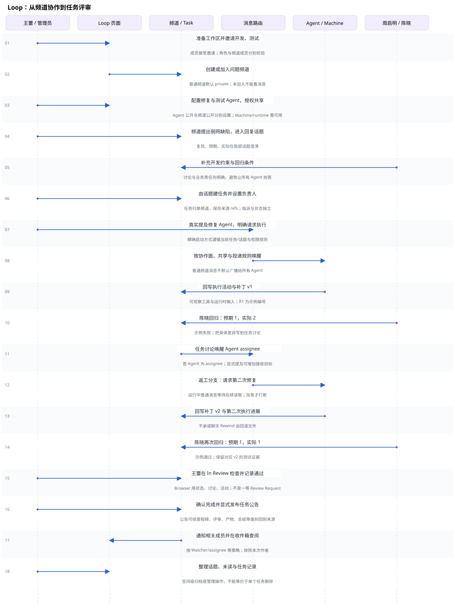
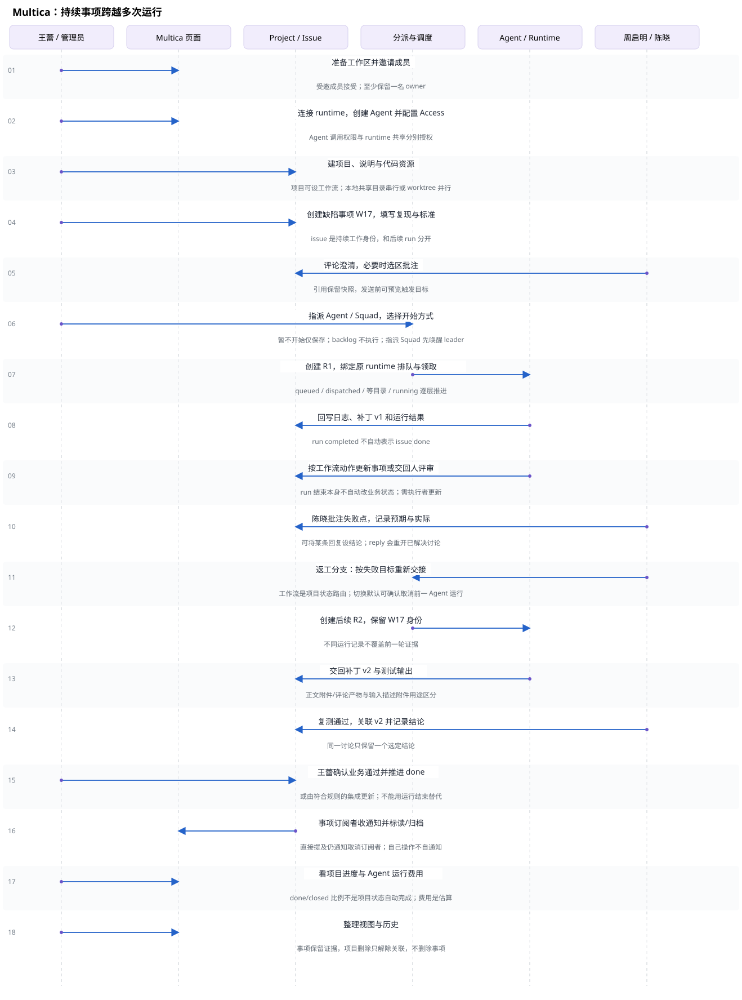
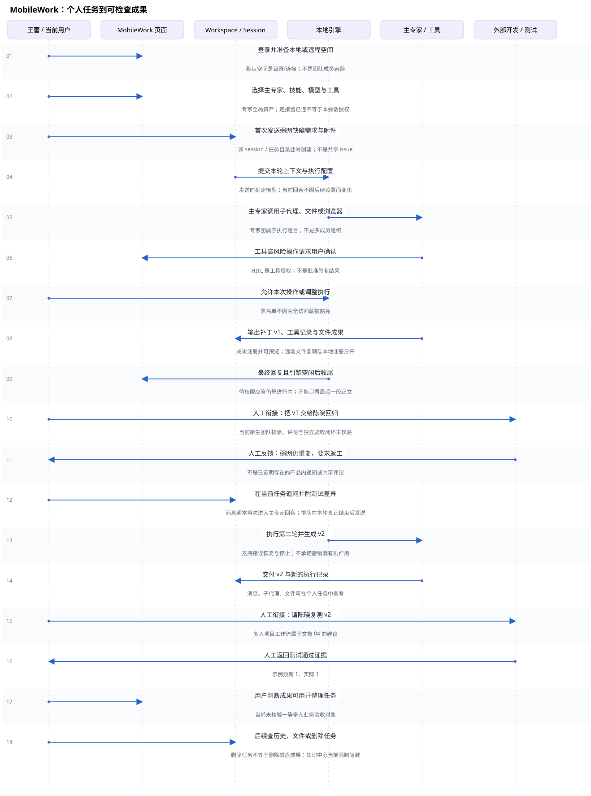
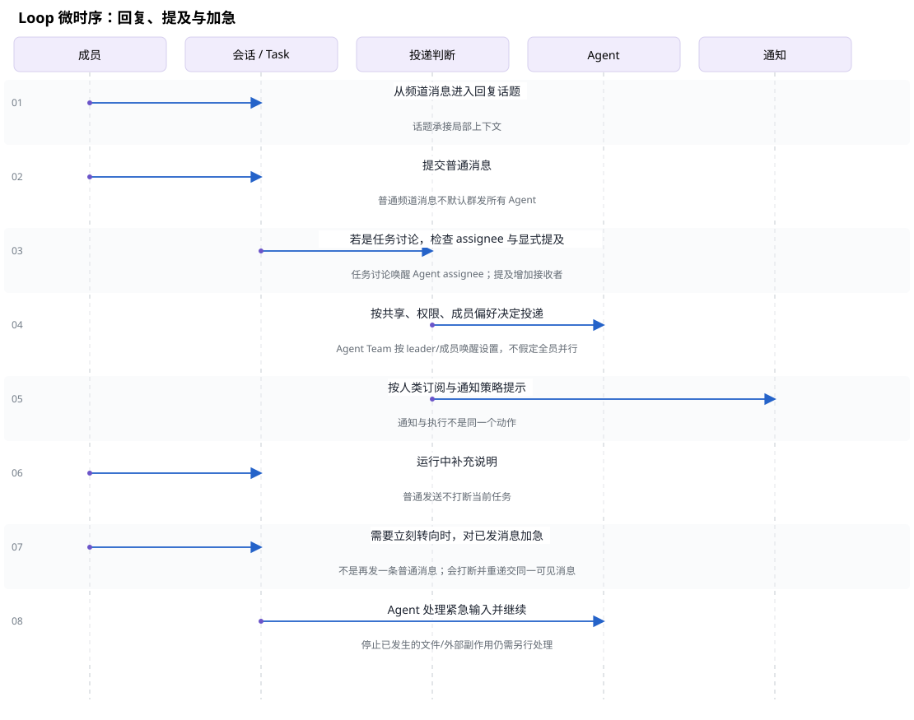
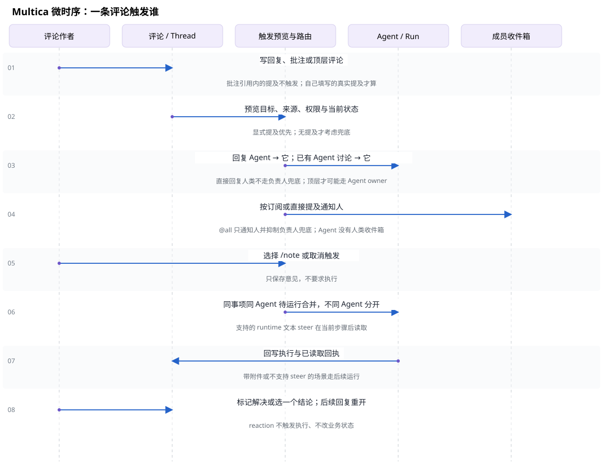
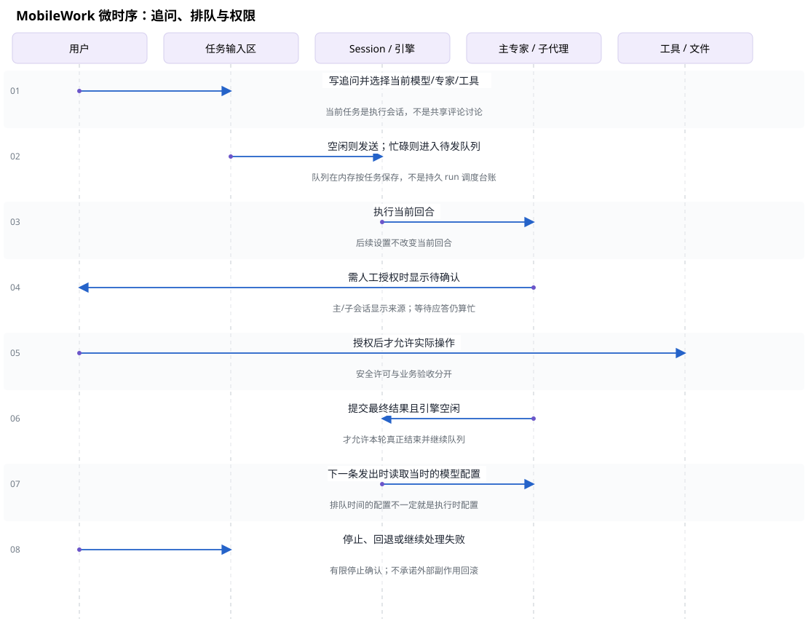

# 整体使用时序图及对比

同一弱网缺陷案例，结果为示例。时序为产品逻辑，不是网络抓包，不代表耗时。

## Loop：从频道协作到任务评审
适合从团队对话逐步收束工作。任务状态、Agent 活动和 Workflow Approval 分别判断；下列测试结果是示例。

[可编辑 Mermaid](图源/loop-end-to-end.mmd)

| 步骤 | 发送者 → 接收者 | 动作 | 边界 |
|---|---|---|---|
| 1 | 王蕾 / 管理员 → Loop 页面 | 准备工作区并邀请开发、测试 | 成员接受邀请；角色与频道成员分别校验 |
| 2 | Loop 页面 → 频道 / Task | 创建或加入问题频道 | 普通频道默认 private；未加入不能看消息 |
| 3 | 王蕾 / 管理员 → Loop 页面 | 配置修复与测试 Agent，授权共享 | Agent 公开与频道公开分别设置；Machine/runtime 需可用 |
| 4 | 王蕾 / 管理员 → 频道 / Task | 频道提出弱网缺陷，进入回复话题 | 复现、预期、实际在局部话题澄清 |
| 5 | 周启明 / 陈晓 → 频道 / Task | 补充开发约束与回归条件 | 讨论与业务责任先明确，避免让所有 Agent 抢答 |
| 6 | 王蕾 / 管理员 → 频道 / Task | 由话题建任务并设置负责人 | 任务归单频道，保存来源 refs；指派与状态独立 |
| 7 | 王蕾 / 管理员 → 消息路由 | 真实提及修复 Agent，明确请求执行 | 精确启动方式遵循当前任务/话题与权限规则 |
| 8 | 消息路由 → Agent / Machine | 按协作面、共享与投递规则唤醒 | 普通频道消息不默认广播给所有 Agent |
| 9 | Agent / Machine → 频道 / Task | 回写执行活动与补丁 v1 | 可观察工具与运行时输入；R1 为示例编号 |
| 10 | 周启明 / 陈晓 → 频道 / Task | 陈晓回归：预期 1，实际 2 | 示例失败；把具体差异写到任务讨论 |
| 11 | 频道 / Task → 消息路由 | 任务讨论唤醒 Agent assignee | 若 Agent 为 assignee；显式提及可增加接收目标 |
| 12 | 消息路由 → Agent / Machine | 返工分支：请求第二次修复 | 运行中普通消息等待后续读取；加急才打断 |
| 13 | Agent / Machine → 频道 / Task | 回写补丁 v2 与第二次执行进展 | 不承诺聊天 Rewind 会回滚文件 |
| 14 | 周启明 / 陈晓 → 频道 / Task | 陈晓再次回归：预期 1，实际 1 | 示例通过；保留对应 v2 的测试证据 |
| 15 | 王蕾 / 管理员 → 频道 / Task | 王蕾在 In Review 检查并记录通过 | Browser 用状态、讨论、活动；不是一等 Review Request |
| 16 | 王蕾 / 管理员 → 频道 / Task | 确认完成并显式发布任务公告 | 公告可按里程碑、评审、产物、总结等类别回到来源 |
| 17 | 频道 / Task → Loop 页面 | 通知相关成员并在收件箱查阅 | 按 Watcher/assignee 等策略；排除本次作者 |
| 18 | 王蕾 / 管理员 → Loop 页面 | 整理话题、未读与任务记录 | 空间级归档是管理操作，不能等价于单个任务删除 |

来源：[L_members](证据索引.html#L_members)、[L_channels](证据索引.html#L_channels)、[L_working](证据索引.html#L_working)、[L_operate](证据索引.html#L_operate)、[L_rewind](证据索引.html#L_rewind)、[L_teams](证据索引.html#L_teams)

## Multica：持续事项跨越多次运行
适合把缺陷当作有持续身份的工作。工作流负责交接规则；事项、负责人、运行、项目状态各有生命周期。

[可编辑 Mermaid](图源/multica-end-to-end.mmd)

| 步骤 | 发送者 → 接收者 | 动作 | 边界 |
|---|---|---|---|
| 1 | 王蕾 / 管理员 → Multica 页面 | 准备工作区并邀请成员 | 受邀成员接受；至少保留一名 owner |
| 2 | 王蕾 / 管理员 → Multica 页面 | 连接 runtime，创建 Agent 并配置 Access | Agent 调用权限与 runtime 共享分别授权 |
| 3 | 王蕾 / 管理员 → Project / Issue | 建项目、说明与代码资源 | 项目可设工作流；本地共享目录串行或 worktree 并行 |
| 4 | 王蕾 / 管理员 → Project / Issue | 创建缺陷事项 W17，填写复现与标准 | issue 是持续工作身份，和后续 run 分开 |
| 5 | 周启明 / 陈晓 → Project / Issue | 评论澄清，必要时选区批注 | 引用保留快照，发送前可预览触发目标 |
| 6 | 王蕾 / 管理员 → 分派与调度 | 指派 Agent / Squad，选择开始方式 | 暂不开始仅保存；backlog 不执行；指派 Squad 先唤醒 leader |
| 7 | 分派与调度 → Agent / Runtime | 创建 R1，绑定原 runtime 排队与领取 | queued / dispatched / 等目录 / running 逐层推进 |
| 8 | Agent / Runtime → Project / Issue | 回写日志、补丁 v1 和运行结果 | run completed 不自动表示 issue done |
| 9 | Agent / Runtime → Project / Issue | 按工作流动作更新事项或交回人评审 | run 结束本身不自动改业务状态；需执行者更新 |
| 10 | 周启明 / 陈晓 → Project / Issue | 陈晓批注失败点，记录预期与实际 | 可将某条回复设结论；reply 会重开已解决讨论 |
| 11 | 周启明 / 陈晓 → 分派与调度 | 返工分支：按失败目标重新交接 | 工作流是项目状态路由；切换默认可确认取消前一 Agent 运行 |
| 12 | 分派与调度 → Agent / Runtime | 创建后续 R2，保留 W17 身份 | 不同运行记录不覆盖前一轮证据 |
| 13 | Agent / Runtime → Project / Issue | 交回补丁 v2 与测试输出 | 正文附件/评论产物与输入描述附件用途区分 |
| 14 | 周启明 / 陈晓 → Project / Issue | 复测通过，关联 v2 并记录结论 | 同一讨论只保留一个选定结论 |
| 15 | 王蕾 / 管理员 → Project / Issue | 王蕾确认业务通过并推进 done | 或由符合规则的集成更新；不能用运行结束替代 |
| 16 | Project / Issue → Multica 页面 | 事项订阅者收通知并标读/归档 | 直接提及仍通知取消订阅者；自己操作不自通知 |
| 17 | 王蕾 / 管理员 → Multica 页面 | 看项目进度与 Agent 运行费用 | done/closed 比例不是项目状态自动完成；费用是估算 |
| 18 | 王蕾 / 管理员 → Multica 页面 | 整理视图与历史 | 事项保留证据，项目删除只解除关联，不删除事项 |

来源：[M_members-roles](证据索引.html#M_members-roles)、[M_agents](证据索引.html#M_agents)、[M_daemon-runtimes](证据索引.html#M_daemon-runtimes)、[M_projects](证据索引.html#M_projects)、[M_project-resources](证据索引.html#M_project-resources)、[M_comments](证据索引.html#M_comments)、[M_assigning-issues](证据索引.html#M_assigning-issues)、[M_tasks](证据索引.html#M_tasks)、[M_workflows](证据索引.html#M_workflows)、[M_inbox](证据索引.html#M_inbox)、[M_analytics](证据索引.html#M_analytics)

## MobileWork：个人任务到可检查成果
当前以个人桌面任务为中心。图中明确写“人工衔接”的步骤是场景所需的人际协作，不宣称软件已原生支持。

[可编辑 Mermaid](图源/work-end-to-end.mmd)

| 步骤 | 发送者 → 接收者 | 动作 | 边界 |
|---|---|---|---|
| 1 | 王蕾 / 当前用户 → MobileWork 页面 | 登录并准备本地或远程空间 | 默认空间是目录/连接；不是团队成员容器 |
| 2 | 王蕾 / 当前用户 → MobileWork 页面 | 选择主专家、技能、模型与工具 | 专家全局资产；连接器已连不等于本会话授权 |
| 3 | 王蕾 / 当前用户 → Workspace / Session | 首次发送弱网缺陷需求与附件 | 新 session / 任务目录此时创建；不是共享 issue |
| 4 | Workspace / Session → 本地引擎 | 提交本轮上下文与执行配置 | 发送时确定模型；当前回合不因后续设置而变化 |
| 5 | 本地引擎 → 主专家 / 工具 | 主专家调用子代理、文件或浏览器 | 专家团属于执行组合；不是多成员组织 |
| 6 | 主专家 / 工具 → MobileWork 页面 | 工具高风险操作请求用户确认 | HITL 是工具授权；不是批准修复结果 |
| 7 | 王蕾 / 当前用户 → 本地引擎 | 允许本次操作或调整执行 | 黑名单不因完全访问就被豁免 |
| 8 | 主专家 / 工具 → Workspace / Session | 输出补丁 v1、工具记录与文件成果 | 成果注册并可预览；远端文件复制与本地注册分开 |
| 9 | 本地引擎 → MobileWork 页面 | 最终回复且引擎空闲后收尾 | 待权限应答仍算进行中；不能只看最后一段正文 |
| 10 | 王蕾 / 当前用户 → 外部开发 / 测试 | 人工衔接：把 v1 交给陈晓回归 | 当前原生团队指派、评论与独立验收闭环未核验 |
| 11 | 外部开发 / 测试 → 王蕾 / 当前用户 | 人工反馈：弱网仍重复，要求返工 | 不是已证明存在的产品内通知或共享评论 |
| 12 | 王蕾 / 当前用户 → Workspace / Session | 在当前任务追问并附测试差异 | 消息通常再次进入主专家回合；排队在本轮真正结束后发送 |
| 13 | 本地引擎 → 主专家 / 工具 | 执行第二轮并生成 v2 | 支持错误恢复与停止；不承诺撤销既有副作用 |
| 14 | 主专家 / 工具 → Workspace / Session | 交付 v2 与新的执行记录 | 消息、子代理、文件可在个人任务中查看 |
| 15 | 王蕾 / 当前用户 → 外部开发 / 测试 | 人工衔接：请陈晓复测 v2 | 多人项目工作流属于文档 04 的建议 |
| 16 | 外部开发 / 测试 → 王蕾 / 当前用户 | 人工返回测试通过证据 | 示例预期 1、实际 1 |
| 17 | 王蕾 / 当前用户 → MobileWork 页面 | 用户判断成果可用并整理任务 | 当前未核验一等多人业务验收对象 |
| 18 | 王蕾 / 当前用户 → Workspace / Session | 后续查历史、文件或删除任务 | 删除任务不等于删除磁盘成果；知识中心当前强制隐藏 |

来源：[W_auth](证据索引.html#W_auth)、[W_workspace](证据索引.html#W_workspace)、[W_experts](证据索引.html#W_experts)、[W_session](证据索引.html#W_session)、[W_connectors](证据索引.html#W_connectors)、[W_hitl-permission](证据索引.html#W_hitl-permission)、[W_files-artifacts](证据索引.html#W_files-artifacts)、[W_flags-code](证据索引.html#W_flags-code)

## Loop 微时序：回复、提及与加急
重点：普通消息、任务讨论、真实提及、加急分别有不同执行含义。

[可编辑 Mermaid](图源/loop-reply.mmd)

| 步骤 | 发送者 → 接收者 | 动作 | 边界 |
|---|---|---|---|
| 1 | 成员 → 会话 / Task | 从频道消息进入回复话题 | 话题承接局部上下文 |
| 2 | 成员 → 会话 / Task | 提交普通消息 | 普通频道消息不默认群发所有 Agent |
| 3 | 会话 / Task → 投递判断 | 若是任务讨论，检查 assignee 与显式提及 | 任务讨论唤醒 Agent assignee；提及增加接收者 |
| 4 | 投递判断 → Agent | 按共享、权限、成员偏好决定投递 | Agent Team 按 leader/成员唤醒设置，不假定全员并行 |
| 5 | 投递判断 → 通知 | 按人类订阅与通知策略提示 | 通知与执行不是同一个动作 |
| 6 | 成员 → 会话 / Task | 运行中补充说明 | 普通发送不打断当前任务 |
| 7 | 成员 → 会话 / Task | 需要立刻转向时，对已发消息加急 | 不是再发一条普通消息；会打断并重递交同一可见消息 |
| 8 | 会话 / Task → Agent | Agent 处理紧急输入并继续 | 停止已发生的文件/外部副作用仍需另行处理 |

来源：[L_channels](证据索引.html#L_channels)、[L_working](证据索引.html#L_working)、[L_teams](证据索引.html#L_teams)

## Multica 微时序：一条评论触发谁
重点：评论内容、通知、执行、讨论解决是四套相互关联但不等价的机制。

[可编辑 Mermaid](图源/multica-reply.mmd)

| 步骤 | 发送者 → 接收者 | 动作 | 边界 |
|---|---|---|---|
| 1 | 评论作者 → 评论 / Thread | 写回复、批注或顶层评论 | 批注引用内的提及不触发；自己填写的真实提及才算 |
| 2 | 评论 / Thread → 触发预览与路由 | 预览目标、来源、权限与当前状态 | 显式提及优先；无提及才考虑兜底 |
| 3 | 触发预览与路由 → Agent / Run | 回复 Agent → 它；已有 Agent 讨论 → 它 | 直接回复人类不走负责人兜底；顶层才可能走 Agent owner |
| 4 | 触发预览与路由 → 成员收件箱 | 按订阅或直接提及通知人 | @all 只通知人并抑制负责人兜底；Agent 没有人类收件箱 |
| 5 | 评论作者 → 触发预览与路由 | 选择 /note 或取消触发 | 只保存意见，不要求执行 |
| 6 | 触发预览与路由 → Agent / Run | 同事项同 Agent 待运行合并，不同 Agent 分开 | 支持的 runtime 文本 steer 在当前步骤后读取 |
| 7 | Agent / Run → 评论 / Thread | 回写执行与已读取回执 | 带附件或不支持 steer 的场景走后续运行 |
| 8 | 评论作者 → 评论 / Thread | 标记解决或选一个结论；后续回复重开 | reaction 不触发执行、不改业务状态 |

来源：[M_comments](证据索引.html#M_comments)、[M_mentioning-agents](证据索引.html#M_mentioning-agents)、[M_inbox](证据索引.html#M_inbox)、[M_tasks](证据索引.html#M_tasks)

## MobileWork 微时序：追问、排队与权限
重点：个人任务消息天然承载执行意图，多人意见应新增独立评论通道。

[可编辑 Mermaid](图源/work-reply.mmd)

| 步骤 | 发送者 → 接收者 | 动作 | 边界 |
|---|---|---|---|
| 1 | 用户 → 任务输入区 | 写追问并选择当前模型/专家/工具 | 当前任务是执行会话，不是共享评论讨论 |
| 2 | 任务输入区 → Session / 引擎 | 空闲则发送；忙碌则进入待发队列 | 队列在内存按任务保存，不是持久 run 调度台账 |
| 3 | Session / 引擎 → 主专家 / 子代理 | 执行当前回合 | 后续设置不改变当前回合 |
| 4 | 主专家 / 子代理 → 用户 | 需人工授权时显示待确认 | 主/子会话显示来源；等待应答仍算忙 |
| 5 | 用户 → 工具 / 文件 | 授权后才允许实际操作 | 安全许可与业务验收分开 |
| 6 | 主专家 / 子代理 → Session / 引擎 | 提交最终结果且引擎空闲 | 才允许本轮真正结束并继续队列 |
| 7 | Session / 引擎 → 主专家 / 子代理 | 下一条发出时读取当时的模型配置 | 排队时间的配置不一定就是执行时配置 |
| 8 | 用户 → 任务输入区 | 停止、回退或继续处理失败 | 有限停止确认；不承诺外部副作用回滚 |

来源：[W_session](证据索引.html#W_session)、[W_hitl-permission](证据索引.html#W_hitl-permission)、[W_message-code](证据索引.html#W_message-code)、[W_experts](证据索引.html#W_experts)
