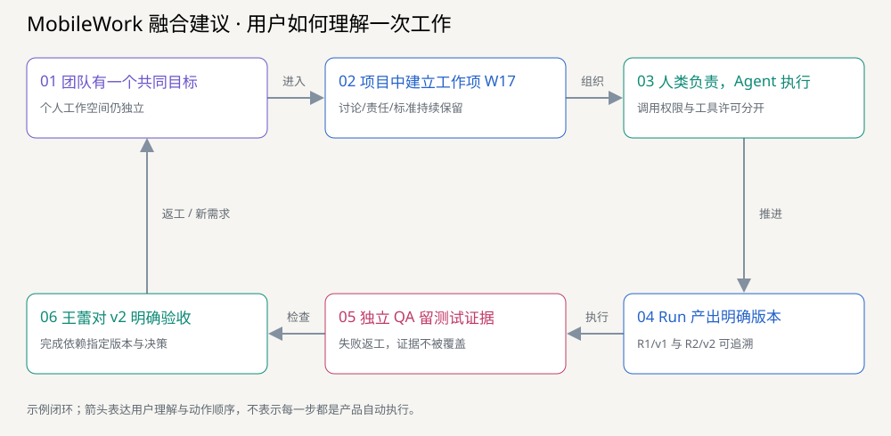
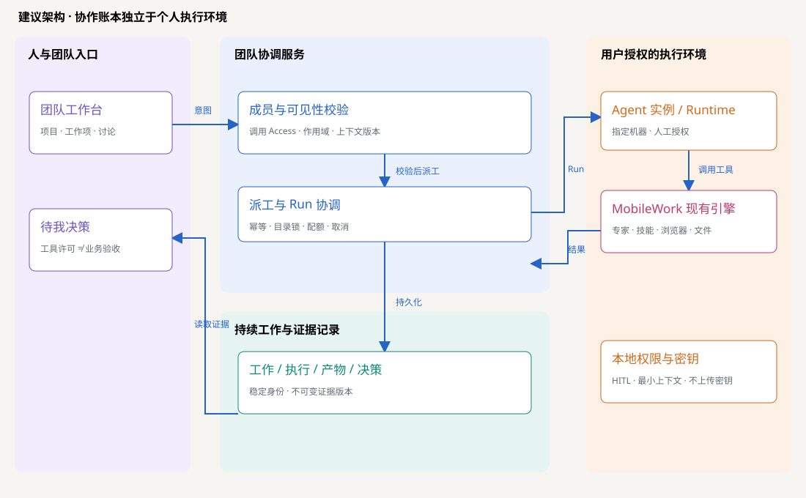
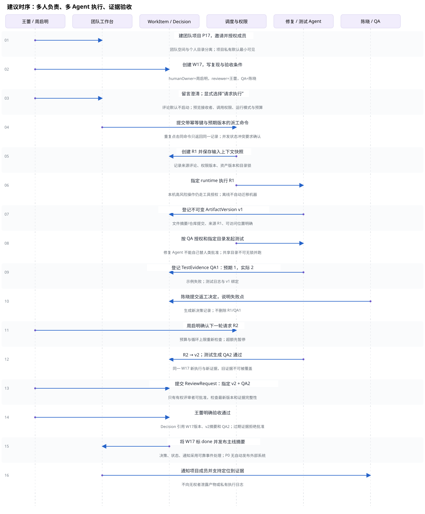
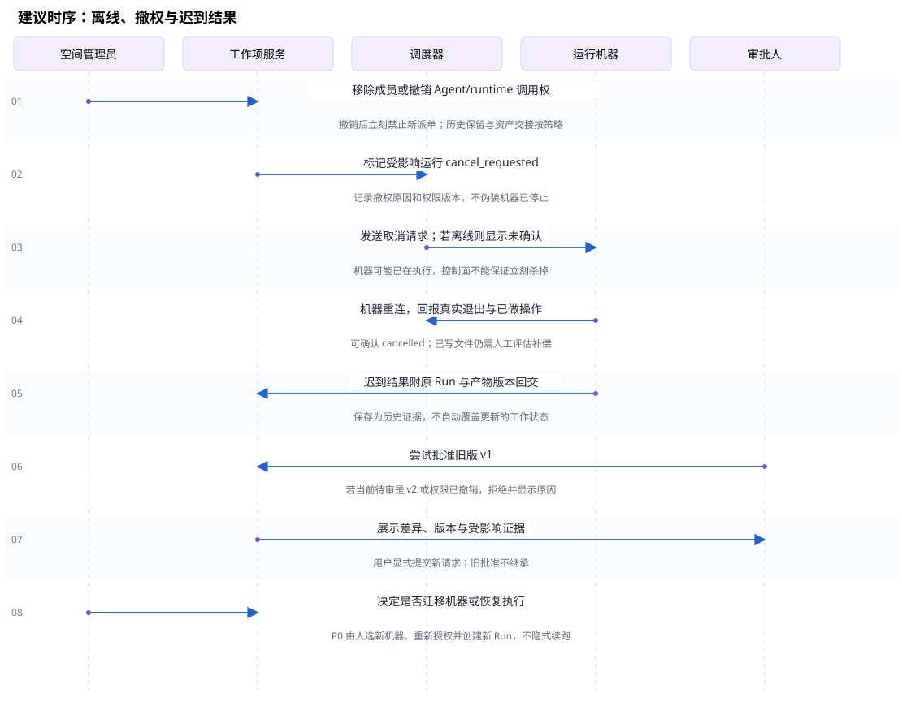

# MobileWork 多人多智能体融合建议

本篇为建议，尚未实现。保留个人桌面执行，新增独立团队工作账本。人物与弱网缺陷为示例。

## 产品判断
人对结果负责，Agent 在授权环境执行，团队按版本化证据验收。Loop 借鉴上下文与显式回源；Multica 借鉴事项/Run/Access；MobileWork 复用专家、技能、工具、浏览器、文件与 HITL。

## 建议思维导图

### 团队空间与身份
- 组织/团队空间与本地工作空间分离
- 邀请、接受、撤销、移除与离职交接
- owner/admin/member 与项目角色
- 私有项目成员校验；管理员不自动读私有内容
- Agent 实例、所有者、调用 Access、机器授权分开

### 共享工作主线
- 项目目标、成员、资料与验收标准
- 工作项：标题、描述、优先级、日期、父子关系
- 一个人类责任人；执行 Agent 可另选
- todo/in_progress/in_review/blocked/done/cancelled
- 状态、负责人、订阅、运行各自独立
- 团队讨论 / 事项评论；P1 再扩完整频道话题

### 评论、回复与通知
- 顶层评论与同根嵌套回复
- 文本、代码、链接、附件与编辑标记
- 作者编辑/删除；管理删除留审计
- 删根留占位与回复；实际清理遵循保留政策
- 默认只留言；请求执行需显式确认目标
- @人通知；@Agent 提供执行预览
- 表情不启动；解决讨论不等于验收
- 订阅、直接提及、未读、失败通知去重
- P1 选区批注、结论替换、评论转子项

### 多 Agent 执行
- 主协调 Agent + 有职责的修复/测试成员
- P0 指定 runtime；不自动跨机器迁移
- 一次 Run 独立状态、上下文快照和触发来源
- 相同命令幂等；排队去重与状态原子校验
- 共享目录串行；独立目录/worktree 才并行
- 预算、轮数、超时、循环检测与暂停
- 人工优先停止；控制面取消与机器确认分开

### 成果、回归与验收
- ArtifactVersion：不可变版本、摘要、来源 Run
- TestEvidence：输入、预期、实际、环境、日志
- ReviewRequest：指定版本与验收人
- Decision：通过/返工/驳回，绑定证据版本
- 新版本不继承旧批准；要求重新评审
- 显式回主线：里程碑、阻塞、产物、验收

### 个人能力复用
- 专家/技能资产 → 授权后实例化团队 Agent
- 连接器定义复用，密钥按运行边界引用
- 桌面浏览器与手动接管
- 本地/远程文件成果与预览
- 现有 HITL、模型选择、错误恢复
- 个人记忆与私有会话默认不共享

### 治理与运营
- 操作审计、可解释投递与权限拒绝
- 工具许可与业务决策分开呈现
- 成员移除撤权、停止新派单、资产交接
- 模型与运行成本、预算配额、异常暂停
- 团队可观测台：工作、运行、产物、决策
- 隐私、保留/删除、导出与恢复策略

## 建议心智模型
团队有一个共同目标 → 项目中建立工作项 W17 → 人类负责，Agent 执行 → Run 产出明确版本 → 独立 QA 留测试证据 → 王蕾对 v2 明确验收

## 对象模型

| 对象 | 字段 | 约束 |
|---|---|---|
| TeamWorkspace | id、组织名、成员、保留策略 | 有 1:N Project；与 LocalWorkspace 无等号关系 |
| Project | id、目标、visibility、成员、资料版本 | 有 1:N WorkItem；有显式团队参与范围 |
| WorkItem | id、projectId、humanOwner、executorRef、status、priority、version、acceptanceCriteria | 人类责任始终明确；1:N Run / Thread / ReviewRequest |
| Comment / Thread | id、rootId、replyToId、author、body、editedAt、deletedAt、version、attachments | 同根回复；消息可见性继承工作项；编辑不偷偷重跑 |
| AgentInstance | id、assetVersion、owner、accessPolicy、runtimeBinding、capabilities | 专家资产可复用；实例调用权限和机器授权分离 |
| DispatchCommand / Run | idempotencyKey、expectedVersion；runId、triggerRef、agentId、runtimeId、inputSnapshot、status、cost | 命令去重；一次 Run 一份执行记录；用户消息队列不充当台账 |
| ArtifactVersion | artifactId、versionId、hash/commit、sourceRunId、storageRef、visibility | 内容和来源不可变；改动创建新版本，不覆盖旧批准 |
| TestEvidence | id、artifactVersion、caseVersion、environment、expected、actual、result、logRef | 包含通过/失败与实际验证范围；不因一句“已测”生成通过 |
| ReviewRequest / Decision | reviewer、workItemVersion、artifactVersions、testEvidenceIds；actor、result、reason、timestamp | 决策不可改写；通过只对指定证据有效，新版本需重新批准 |
| Subscription / AuditEvent | 对象、用户、通知偏好；actor、action、targetVersion、result | 直接提及单独处理；关注、已读与 Agent 执行分开 |

## 评论与回复规则

| 微功能 | 建议 | 边界 |
|---|---|---|
| 发送文本/附件 | 默认“仅留言”；草稿与失败重试保留 | 提交前展示可见范围；附件单独检查权限与配额 |
| 回复某人 | 保存 rootId 与 replyToId；仍留在同一顶层讨论 | 不会因回复 Agent 就默认执行；主动点击“请求执行” |
| 提及人 | 使用真实身份候选，触发通知 | 不改变负责人、状态或执行者；避免作者自通知 |
| 提及 Agent / 小队 | 选择后展示“仅提及 / 请求执行”与权限状态 | 执行才创建派工命令；P0 小队仅协调 Agent 可受控派成员 |
| 编辑评论 | 作者可改，显示编辑标记并保留版本 | 不自动重跑旧请求；新增通知可预览，重跑需新命令 |
| 删除评论 | 作者删除；管理员管理删除留原因与审计 | 根评论留占位，回复与已用执行快照按保留策略留存；不能删掉合法证据链 |
| 重复/并发提交 | 客户端稳定命令键；服务端原子去重与版本校验 | 同一键不同内容拒绝；发现远端更新让用户选合并或重新提交 |
| 表情回应 | 同一人同表情开/关，仅记录反应 | 不唤醒、不变负责人、不代替通过 |
| 解决/重开讨论 | 标记讨论已解决；新回复可重开并提示 | 讨论解决与 WorkItem done、Decision approved 独立 |
| 批注与结论 P1 | 选区快照、编号、草稿；同讨论一个选定结论 | 新结论替换需留历史；引用内提及不触发；限制容量以压测确定 |
| 只留言/执行预览 | 明确本次通知人、Agent、权限、忙闲与预计资源 | 不能只用颜色表示；无权目标不可静默略过 |
| 运行中补充 | P0 仅“本轮后开始”或“停止后重新执行” | 仅在引擎能证明送达时 P1 开放无中断插话，保留回执 |
| 通知与订阅 | 项目/工作项订阅，直接提及，分配、失败和待验收去重 | 取消关注不取消直接提及；已读只影响人的注意力，不影响执行 |
| 评论转子项 P1 | 选定评论及此前必要上下文生成来源快照 | 不自动带出无权内容；子项责任/权限单独确认，后续源更新提示而不覆盖 |

## 分期实施

| 阶段 | 内容 | 标准 | 取舍 |
|---|---|---|---|
| P0 · 跑通一条可信闭环 | 团队成员与最小权限；项目/工作项；评论/回复/真实提及；显式派工；指定 runtime；Run/目录锁；产物版本；QA证据；人工验收；通知审计 | 用弱网缺陷案例完成 R1 失败 → R2 通过；刷新/重连不丢责任与证据；越权与重复执行可阻止 | 使用已有专家/技能/工具引擎；不先做全功能聊天、不开放自治跨机器调度 |
| P1 · 降低跨人协作成本 | 线程批注与结论；状态交接模板；Agent 小队受控派工；可送达插话；可保存视图；显式频道回源；个人任务升格工作项 | 并发编辑、来源快照、权限撤销和人工接管均可解释；能完成两个独立项目试点 | 有稳定 P0 证据对象和授权接口之后扩展；每项单独确认接入工具能力 |
| P2 · 在约束内扩大自动化 | 可视化工作流；定时与事件触发；更多运行适配器；模板与运营分析；条件满足后目录隔离并行与人工确认机器迁移 | 预算、异常暂停、循环限制、恢复流程和历史兼容通过试点 | 避免直接复用旧定时任务作为多租户调度器；引入前先做迁移与兼容验证 |

## P0验收

| 场景 | 操作 | 结果 |
|---|---|---|
| 重复派工 | 同一评论命令连续提交或网络重传 | 只产生一个 Run；同键不同内容拒绝，界面能定位原 Run |
| 明确责任 | 同时 @修复与测试，但负责人未改 | 人类责任人不被提及覆盖；执行者与责任人分别展示 |
| 普通回复 | 陈晓在任务内只补一句测试条件 | 保存评论并通知有权成员；不创建 Run、不消耗执行预算 |
| 并发状态更新 | 王蕾验收时周启明已提交 v3 | 旧 expectedVersion 或证据集不匹配，不能把 v2 批准扩展到 v3 |
| 成员撤权 | 移除原本可执行的成员 | 新派单被拒；活动运行显示请求取消/未确认/已停止，结果保留审计 |
| 目录竞争 | 两个 Agent 请求同时修改同一共享目录 | 后者等待或拒绝，不出现无锁双写；独立目录并行需明确隔离 |
| QA 不通过 | v1 测试实际 2、预期 1 | 留下不可变失败证据，不能 done；返工生成后续 Run |
| 版本验收 | v2 + QA2 通过后提交人工通过 | 只有指定有权评审者创建 Decision；Decision 可反查输入、版本、测试与执行 |
| 机器离线 | 已入队任务绑定机器断联 | 显示等待/失败及原因；不暗中发到另一台机器；恢复有幂等与原版本检查 |
| 停止与迟到结果 | 停止后机器迟到回报成功 | 不自动覆盖已停止或新工作状态；仍可查看已发生副作用与历史产物 |
| 隐私 | 个人会话含私有记忆、密钥或无权附件 | 团队上下文仅装配被授权快照；密钥不入评论/提示词/共享日志 |
| 刷新与恢复 | P0 场景中途关闭客户端再进入 | 工作项、Run、产物、测试与决策由服务端持续恢复；内存消息队列不当作持久调度 |

## 建议时序：多人负责、多 Agent 执行、证据验收
以下全部为产品与技术建议。R1 失败、R2 通过是贯穿示例，尚非现有功能。

[可编辑 Mermaid](图源/proposal-end-to-end.mmd)

1、王蕾 / 周启明 → 团队工作台：建团队项目 P17，邀请并授权成员。团队空间与个人目录分离；项目私有默认最小可见

2、王蕾 / 周启明 → WorkItem / Decision：创建 W17，写复现与验收条件。humanOwner=周启明，reviewer=王蕾，QA=陈晓

3、王蕾 / 周启明 → 团队工作台：留言澄清；显式选择“请求执行”。评论默认不启动；预览接收者、调用权限、运行模式与预算

4、团队工作台 → 调度与权限：提交带幂等键与预期版本的派工命令。重复点击同命令只返回同一记录；并发状态冲突要求确认

5、调度与权限 → WorkItem / Decision：创建 R1 并保存输入上下文快照。记录来源评论、权限版本、资产版本和目录锁

6、调度与权限 → 修复 / 测试 Agent：指定 runtime 执行 R1。本机高风险操作仍走工具授权；离线不自动迁移机器

7、修复 / 测试 Agent → WorkItem / Decision：登记不可变 ArtifactVersion v1。文件摘要/仓库提交、来源 R1、可访问位置明确

8、调度与权限 → 修复 / 测试 Agent：按 QA 授权和指定目录发起测试。修复 Agent 不能自己替人类批准；共享目录不可无锁并跑

9、修复 / 测试 Agent → WorkItem / Decision：登记 TestEvidence QA1：预期 1，实际 2。示例失败；测试日志与 v1 绑定

10、陈晓 / QA → WorkItem / Decision：陈晓提交返工决定，说明失败点。生成新决策记录；不删除 R1/QA1

11、王蕾 / 周启明 → 调度与权限：周启明确认下一轮请求 R2。预算与循环上限重新检查；超额先暂停

12、修复 / 测试 Agent → WorkItem / Decision：R2 → v2；测试生成 QA2 通过。同一 W17 新执行与新证据，旧证据不可被覆盖

13、王蕾 / 周启明 → WorkItem / Decision：提交 ReviewRequest：指定 v2 + QA2。只有有权评审者可批准，检查最新版本和证据完整性

14、王蕾 / 周启明 → WorkItem / Decision：王蕾明确验收通过。Decision 引用 W17版本、v2摘要和 QA2；过期证据拒绝批准

15、WorkItem / Decision → 团队工作台：将 W17 标 done 并发布主线摘要。决策、状态、通知采用可靠事件处理；P0 无自动发布外部系统

16、团队工作台 → 陈晓 / QA：通知项目成员并支持定位到证据。不向无权者泄露产物或私有执行日志

## 建议时序：离线、撤权与迟到结果
建议把“请求取消”和“确认停止”分开；过期结果可追溯，但不能越过新权限或新版本。

[可编辑 Mermaid](图源/proposal-revoke.mmd)

1、空间管理员 → 工作项服务：移除成员或撤销 Agent/runtime 调用权。撤销后立刻禁止新派单；历史保留与资产交接按策略

2、工作项服务 → 调度器：标记受影响运行 cancel_requested。记录撤权原因和权限版本，不伪装机器已停止

3、调度器 → 运行机器：发送取消请求；若离线则显示未确认。机器可能已在执行，控制面不能保证立刻杀掉

4、运行机器 → 调度器：机器重连，回报真实退出与已做操作。可确认 cancelled；已写文件仍需人工评估补偿

5、运行机器 → 工作项服务：迟到结果附原 Run 与产物版本回交。保存为历史证据，不自动覆盖更新的工作状态

6、审批人 → 工作项服务：尝试批准旧版 v1。若当前待审是 v2 或权限已撤销，拒绝并显示原因

7、工作项服务 → 审批人：展示差异、版本与受影响证据。用户显式提交新请求；旧批准不继承

8、空间管理员 → 工作项服务：决定是否迁移机器或恢复执行。P0 由人选新机器、重新授权并创建新 Run，不隐式续跑

## 技术验证与度量
团队工作服务与个人执行引擎通过 Run 适配契约连接。先验证指定 runtime、取消确认、权限撤销、版本化结果回交，再决定自建或集成。现有 API 不证明具备可嵌入 SDK 或许可适配。
指标：闭环完成率、错误执行率、首轮通过率、分阶段等待、追溯完整率、单位验收成本、权限拒绝与恢复。目标与阈值由试点确定，不虚构基线。

完整权限/上下文/保留策略、IA 与原型升级说明见同名 HTML。
